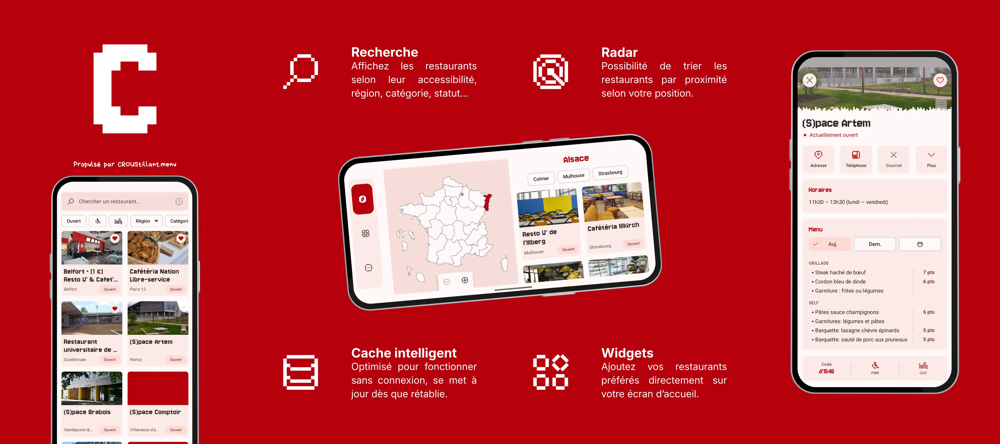

# 🔴 Croustillapp

  

<table>
  <tr>
    <td width="30%" valign="top">
      <h3>Sécurité</h3>
      
L'application ne conserve ni ne partage aucune donnée personnelle. Elle n'utilise que des bibliothèques libres et connues.

      <h3>Code libre</h3>
      
Le code source de l'application est entièrement disponible sur le GitHub dédié et est consultable par tous.

    </td>
    <td width="40%" valign="top">
      <h3>Informations</h3>
      
<strong>Croustillapp</strong> est une interface open-source pour l'API publique <a href="https://croustillant.menu/fr" target="_blank">CROUStillant.menu</a>, vous permettant d'accéder aux informations de près de 1 000 restaurants universitaires référencés.

      
L'application vous accompagne au quotidien pour consulter les menus des restaurants qui comptent pour vous.

      
Croustillapp n'est pas l'application officielle du projet CROUStillant.

      

        
         
        

    </td>
    <td width="30%" valign="top">
      <h3>Détails</h3>
      <h4>Configuration</h4>
      
Pensé pour Android 16. Fonctionne dès Android 13.

      <h4>Crédits</h4>
      
App réalisée avec <a href="https://github.com/CROUStillant-Developpement/CROUStillantAPI" target="_blank">CROUStillant</a> de <a href="https://github.com/PaulBayfield" target="_blank">Paul Bayfield</a>.

      <h4>Licence</h4>
      
<a href="LICENSE">Apache 2.0</a>

    </td>
  </tr>
</table>
